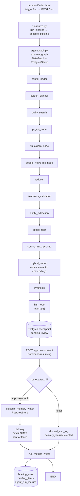

# Signal — 5-minute architecture and live-demo script

Grounded in the current repository. Line numbers were checked against the working tree on 19 Oct 2026.

Before you present: `agent/graph.py` in this working tree does not parse. The assignment `PIPELINE_NODES: tuple[str, ...] = (` was removed; a bare tuple remains at lines 139–157, and later code still references `PIPELINE_NODES` (lines 192, 204, 208). `git diff` shows that line present on HEAD. Restore it before a live run, or the API cannot import the graph. The edges and node order below are otherwise intact.

---

## 1. One-line introduction — 10 seconds

Signal turns Indian startup news into a briefing I can approve, then emails that briefing and saves the run.

---

## 2. Complete spoken script — about 4 minutes

Signal is a briefing pipeline for Indian startup news: funding, founders, accelerators, and ecosystem moves. I click Trigger Run, one LangGraph pipeline researches the sources, pauses for my approval, and only then emails the briefing and writes the run to Postgres.

The button is `triggerRun` in `frontend/index.html`. It creates a thread id with `newRunThreadId` — `run_` plus random hex — and `apiFetch` POSTs `{ thread_id }` to `/run`. `apiFetch` uses `API_BASE` from `frontend/config.js`. In this checkout that is `http://localhost:8080`. It sends the Supabase access token as `Authorization: Bearer …`. The token lives in a JavaScript variable, not localStorage. The POST stays open until the graph pauses or finishes. Meanwhile `pollStatus` calls `GET /agent/status?thread_id=…` every second and the header shows the current node.

That request hits `run_pipeline` in `api/routes.py`. FastAPI validates the body as `RunRequest`. JWT middleware in `api/main.py` has already verified the token and stored the user id from the `sub` claim. `run_pipeline` overwrites any user id in the body with that identity, then `execute_pipeline` calls `execute_graph` in `agent/graph.py`. The JSON response is a `RunResponse`: run id, the same thread id, and status `pending_hitl`, `completed`, or `failed`.

The graph is one `StateGraph` over `SignalState`. It is compiled once with a Postgres checkpointer and a Postgres store. The edges are a single sequence. It is not a multi-agent swarm, and the four research sources are not a parallel fan-out. `config_loader` reads `user_configs` and loads procedural and semantic memory from the store. `search_planner` builds the query plan. `tavily_search`, `yc_api_node`, `hn_algolia_node`, and `google_news_rss_node` run one after another. `raw_findings` uses an append reducer, so each source adds to the list. `reducer` reads that merged list. `freshness_validation` drops items older than 30 days. `entity_extraction` calls `gpt-4o-mini` for company, funding, and category, and sets confidence from a source-trust table, minus a small penalty when the date is missing. `scope_filter` drops out-of-scope locations, stages, and amounts. `source_trust_scoring` sorts by that confidence. `hybrid_dedup` drops URL, title, and embedding duplicates. `synthesis` calls `gpt-4o` and writes `briefing_draft`, `briefing_final`, and `briefing_items`.

`hitl_node` then calls LangGraph `interrupt()` with the draft. The checkpointer saves the thread in Postgres and `execute_graph` returns. No email has been sent. `briefing_runs` has not been inserted. The review screen loads `GET /briefings/{run_id}?thread_id=…`, and `_briefing_from_checkpoint` reads that paused state.

Approve and Reject call `submitHITL`, which POSTs to `/briefings/{run_id}/approve` or `/reject` with the same thread id. `_resume_hitl` calls `graph.invoke(Command(resume=…), config)` on that thread. That continues the checkpoint. It does not start a new run or repeat the research. `route_after_hitl` sends approve to `episodic_memory_writer`, then `delivery`, then `run_metrics_writer`. Reject goes to `discard_and_log`, which sets `delivery_status` to `rejected`, skips email and episodic memory, and still reaches `run_metrics_writer`.

`delivery` sends `briefing_final` through Gmail SMTP. It returns `sent` or `failed`. A failed send does not raise, so the run can still be saved. `run_metrics_writer` inserts `briefing_runs`, `briefing_items`, and `agent_run_metrics`. Checkpoints and long-term memory are in the same Postgres database, via `PostgresSaver` and `PostgresStore`. Application rows are the tables in `database/schema.sql`.

Two decisions are worth pointing at. The pause is a durable interrupt on `thread_id`, so approval resumes finished work instead of re-running it. Email runs only on the approve path, after episodic memory, and the database write is last, so a rejected draft is recorded as rejected and is not delivered.

---

## 3. Synchronized live-demo runbook

Stay on the dashboard until the graph section. Open files in this order: `frontend/index.html`, `api/routes.py`, `agent/graph.py`, `agent/state.py`, `agent/nodes/hitl.py`, back to the two functions already open, then `agent/nodes/delivery.py` and `agent/nodes/run_metrics_writer.py`.

| Time | What I show in the application | File to open in Cursor | Function or code location | What I say |
| --- | --- | --- | --- | --- |
| 0:00–0:12 | Dashboard header. Point at **Trigger Run**. Do not click it yet. | — | — | “Signal turns Indian startup news into a briefing I can approve, then emails that briefing and saves the run.” |
| 0:12–0:45 | Stay on the dashboard. Point at the status pill and the API host chip. | `frontend/index.html` | Button `run-button` line 892 calls `triggerRun`. Function `triggerRun` line 1943. `newRunThreadId` line 1783. `apiFetch` line 1436. `API_BASE` line 1210. | “Trigger Run calls `triggerRun`. It mints a `thread_id`, then POSTs `{ thread_id }` to `/run` with the Bearer token. This POST stays open until the graph pauses. `pollStatus` at line 1865 refreshes the header every second while it is running.” |
| 0:45–0:55 | Glance at the host chip so it matches the URL you will name. | `frontend/config.js` | `window.API_BASE_URL` line 5 | “This checkout points the browser at localhost port 8080. The host chip should match whatever environment I opened.” |
| 0:55–1:25 | Leave the browser on the dashboard. | `api/routes.py` | `run_pipeline` line 1541. `execute_pipeline` line 432. `RunRequest` is in `api/schemas.py` line 107. | “`run_pipeline` validates `RunRequest`, replaces `user_id` with the JWT subject, and calls `execute_pipeline`, which calls `execute_graph`. The response is run id, thread id, and `pending_hitl`, `completed`, or `failed`.” |
| 1:25–2:05 | Optional: if a previous run is already pending, leave it. Do not start a new one. | `agent/graph.py` | Edges lines 109–136. `graph = builder.compile(...)` line 453. `execute_graph` line 668. | “This is one sequential `StateGraph`. Start goes to `config_loader`, then the planner, then Tavily, YC, Hacker News, and Google News in that order, then reducer through synthesis, then `hitl_node`. It is compiled with a Postgres checkpointer and store. `execute_graph` invokes it with `configurable.thread_id`.” |
| 2:05–2:35 | — | `agent/state.py` | `SignalState` line 88. `raw_findings` line 98. | “Every node reads and writes this shared state. `raw_findings` appends. Later fields — scored findings, the draft, `hitl_decision`, `delivery_status` — are replaced by the node that owns them.” |
| 2:35–3:05 | If you have a saved briefing, you can flash the findings list. Otherwise stay in the editor. | Stay on `agent/graph.py` edges 109–122. Node files if asked: `config_loader` in `agent/nodes/config_loader.py` line 136; `search_planner` line 35; `freshness_validation` line 25; `entity_extraction` line 48; `scope_filter` line 50; `source_trust_scoring` line 4; `hybrid_dedup` line 155; `synthesis` line 57. | “Config and memory load first. The planner builds queries. The four sources append findings. Freshness drops anything older than 30 days. Extraction structures entities and scores confidence. Scope filter, trust sort, and dedup narrow the list. Synthesis writes the draft with `gpt-4o`.” |
| 3:05–3:35 | Open an existing **pending** briefing if you have one, so the review screen is visible. Otherwise describe it and do not wait on a new run. | `agent/nodes/hitl.py` | `interrupt(payload)` line 28 inside `hitl_node` line 14. `route_after_hitl` line 53. | “After synthesis, `hitl_node` calls `interrupt()` with the draft. LangGraph checkpoints that pause and returns. The review screen is that checkpoint, loaded by `GET /briefings/{run_id}` with the thread id. Approve continues; reject does not.” |
| 3:35–4:00 | On the review screen, point at **Reject** and **Approve & Deliver**. Do not click unless this run is disposable. | `frontend/index.html` | Buttons lines 970–971 call `submitHITL`. Function line 3664. | “Approve posts `/briefings/{run_id}/approve?thread_id=…`. Reject posts the reject route. Same thread id. The UI then waits on that POST the same way it waited on `/run`.” |
| 4:00–4:15 | — | `api/routes.py` | `approve_briefing` line 919. `reject_briefing` line 934. `_resume_hitl` line 949, `Command(resume=…)` line 988. | “Resume is `Command(resume=action)` on the existing checkpoint. Research does not run again. `route_after_hitl` sends approve to memory and email, and reject to discard.” |
| 4:15–4:30 | If you already have a completed briefing, open it and point at the delivered text or the metrics screen. Say the status you actually see. | `agent/nodes/delivery.py` `delivery` line 357. Then `agent/nodes/run_metrics_writer.py` `run_metrics_writer` line 315 and `_persist_metrics` line 189. `discard_and_log` line 6 if you mention reject. | “Delivery emails `briefing_final` and sets `sent` or `failed`. It does not raise on a failed send. Metrics then insert the run, the items, and the metrics row. Reject skips email, sets `delivery_status` to `rejected`, and still writes the row.” |

Stop at 4:30. If they ask a follow-up, use Section 5. Do not open the scheduler unless they ask about unattended runs.

---

## 4. Architecture map

`edit` is a valid graph decision and follows the approve branch. The current UI and the approve/reject routes do not send it.

---

## 5. Code navigation index

| Order | File path | Symbol/function/node | Why I open it |
| --- | --- | --- | --- |
| 1 | `frontend/index.html` | `#run-button` line 892; `triggerRun` line 1943 | Shows the click that starts a run. |
| 2 | `frontend/index.html` | `newRunThreadId` line 1783 | Shows where `thread_id` is created (`run_` + 12 hex chars). |
| 3 | `frontend/index.html` | `API_BASE` line 1210; `apiFetch` line 1436; `accessToken` line 1213 | Shows base URL and `Authorization: Bearer`. |
| 4 | `frontend/index.html` | `pollStatus` line 1865; `POLL_RUNNING_MS` line 1760 | Shows 1-second polling of `/agent/status` while a run is in flight. |
| 5 | `frontend/config.js` | `window.API_BASE_URL` line 5 | Shows the API origin this page actually calls. |
| 6 | `api/main.py` | `jwt_auth_middleware` line 39 | Shows JWT check before the route. |
| 7 | `api/auth.py` | `verify_supabase_jwt` line 81; `get_current_user` line 147 | Shows token verification and `AuthUser`. |
| 8 | `api/schemas.py` | `RunRequest` line 107; `RunResponse` line 160 | Shows the request and response models. |
| 9 | `api/routes.py` | `run_pipeline` line 1541; `execute_pipeline` line 432; `_resolve_status` line 86 | Shows route → graph → status. |
| 10 | `api/routes.py` | `get_agent_status` line 552 | Shows what the poll endpoint returns. |
| 11 | `agent/graph.py` | `builder.add_edge` lines 109–136; `builder.compile` line 453 | Shows node order, branches, checkpointer, and store. |
| 12 | `agent/graph.py` | `execute_graph` line 668; `build_initial_state` line 627 | Shows first invoke versus `resume=True` (API resume uses `Command` instead). |
| 13 | `agent/state.py` | `SignalState` line 88 | Shows the shared state. |
| 14 | `agent/nodes/config_loader.py` | `config_loader` line 136 | Loads `user_configs` plus procedural and semantic memory. |
| 15 | `agent/nodes/search_planner.py` | `search_planner` line 35 | Builds Tavily, YC, HN, and RSS queries. |
| 16 | `agent/nodes/tavily_search.py` | `tavily_search` line 56 | First research node; returns `raw_findings`. |
| 17 | `agent/nodes/yc_api.py` | `yc_api_node` line 44 | YC companies API. |
| 18 | `agent/nodes/hn_algolia.py` | `hn_algolia_node` line 38 | Hacker News Algolia. |
| 19 | `agent/nodes/google_news_rss.py` | `google_news_rss_node` line 30 | Google News RSS. |
| 20 | `agent/nodes/reducer.py` | `reducer` line 4 | Logs the merged `raw_findings` list. |
| 21 | `agent/nodes/freshness_validation.py` | `freshness_validation` line 25 | 30-day window (`FRESHNESS_WINDOW_DAYS` line 5). |
| 22 | `agent/nodes/entity_extraction.py` | `entity_extraction` line 48 | Structured extraction and confidence score. |
| 23 | `agent/nodes/scope_filter.py` | `scope_filter` line 50 | India / stage / amount filter. |
| 24 | `agent/nodes/source_trust_scoring.py` | `source_trust_scoring` line 4 | Sorts by `confidence_score`. |
| 25 | `agent/nodes/hybrid_dedup.py` | `hybrid_dedup` line 155 | URL, title, and embedding dedup; writes embeddings before HITL. |
| 26 | `agent/nodes/synthesis.py` | `synthesis` line 57 | Writes the briefing draft and items. |
| 27 | `agent/nodes/hitl.py` | `hitl_node` line 14; `interrupt` line 28; `route_after_hitl` line 53 | Pause and the approve/reject branch. |
| 28 | `api/routes.py` | `_briefing_from_checkpoint` line 219; `get_briefing` line 766 | Review screen reads the checkpoint when no DB row exists. |
| 29 | `frontend/index.html` | Review buttons lines 970–971; `showHITL` line 3747; `submitHITL` line 3664 | Approve and Reject requests. |
| 30 | `api/routes.py` | `approve_briefing` line 919; `reject_briefing` line 934; `_resume_hitl` line 949 | Resume with `Command(resume=…)`. |
| 31 | `agent/nodes/episodic_memory_writer.py` | `episodic_memory_writer` line 15 | Approve path only. `store.put` at line 43. |
| 32 | `agent/nodes/delivery.py` | `delivery` line 357 | Gmail SMTP. Returns `sent` or `failed`. |
| 33 | `agent/nodes/discard_and_log.py` | `discard_and_log` line 6 | Reject path. Sets `delivery_status` to `rejected`. |
| 34 | `agent/nodes/run_metrics_writer.py` | `run_metrics_writer` line 315; `_persist_metrics` line 189 | Inserts the run after approve or reject. |
| 35 | `database/schema.sql` | `briefing_runs` line 34; `briefing_items` line 66; `agent_run_metrics` line 181 | Application tables. Checkpoint tables come from LangGraph `setup()`, not this file. |

Search terms if a line has shifted: `async function triggerRun`, `def run_pipeline`, `def execute_graph`, `def hitl_node`, `def _resume_hitl`, `def delivery`, `def run_metrics_writer`.

---

## 6. Key technical facts to remember

1. The browser calls `POST /run` with `{ thread_id }` and a Supabase Bearer token. `frontend/config.js` sets the API origin. This checkout uses `http://localhost:8080`. A production URL is commented on line 2; do not assume it is active.
2. `run_pipeline` ignores a client-supplied `user_id`. Identity is `request.state.user_id` from the JWT `sub` claim.
3. `POST /run` is synchronous. It returns when `interrupt()` pauses the graph or when the graph reaches `END`. It is not a background job.
4. The graph is defined and compiled in `agent/graph.py`: `builder.compile(checkpointer=PostgresSaver, store=PostgresStore)` on the `DATABASE_URL` pool.
5. Execution order is strictly sequential: config → planner → Tavily → YC → HN → Google News → reducer → freshness → entities → scope → trust sort → dedup → synthesis → HITL. Approve continues to episodic memory → delivery → metrics. Reject continues to discard → metrics.
6. Nodes share `SignalState`. Research nodes append `raw_findings` because that field is `Annotated[list, operator.add]`.
7. `hitl_node` pauses with `interrupt(payload)`. Until resume, the draft lives in the LangGraph checkpoint. `get_briefing` serves it from `graph.get_state` when `briefing_runs` has no row.
8. Resume is `graph.invoke(Command(resume="approve"|"reject"), config)` on the same `thread_id`. A new `POST /run` would start another thread and repeat research.
9. Checkpoints and store memory are created by `PostgresSaver.setup()` and `PostgresStore.setup()`. `briefing_runs`, `briefing_items`, and `agent_run_metrics` are inserted only in `run_metrics_writer`, after the human decision.
10. Approve can email. `delivery_status` is `sent` or `failed`. Failure is returned in state and does not raise, so metrics still run. Reject sets `delivery_status` to `rejected` and does not call `delivery` or `episodic_memory_writer`.
11. `hybrid_dedup` writes embeddings into the Postgres store before the pause. Reject does not roll those back. Episodic memory is written only on approve or edit.
12. `feedback_collector` and `procedural_memory_updater` are not nodes on this graph. Item feedback is `POST /items/{item_id}/feedback`, which writes `user_feedback` directly. That path does not update procedural memory. `search_planner` reads `query_boost_terms` and appends up to three of them. It loads `query_suppress_terms` and does not use them.
13. The graph accepts `edit` and treats it like approve. The UI only sends approve or reject. `HITLActionRequest` in `api/schemas.py` is not used by those routes.
14. The cost and finding caps live inside `entity_extraction`: stop further extraction after 50 findings or an estimated $0.50. They do not abort the rest of the graph. `config_loader` also overwrites `run_type` to `"manual"` on every run, including scheduler calls that passed `run_type="scheduled"`.
15. Working tree: `agent/graph.py` is missing `PIPELINE_NODES: tuple[str, ...] = (` before line 139. Restore it from HEAD before importing the app.

---

## 7. Live-demo preparation

- Confirm the page you will open. `frontend/config.js` line 5 is `http://localhost:8080`. CORS in `api/main.py` also allows `http://localhost:8000`, `http://localhost:3000`, `https://signal-topaz-nu.vercel.app`, and one Vercel preview origin. The header chip `#api-host-chip` shows the host the page is calling. Use that host. Do not invent a URL in the interview.
- Log in before the call. The token is memory-only, so a refresh returns you to the login screen.
- Prefer an existing completed briefing and, if you have one, an existing pending review. A fresh Trigger Run blocks on Tavily, YC, Hacker News, Google News, embeddings, and two OpenAI calls. That will not fit in five minutes.
- Restore `PIPELINE_NODES: tuple[str, ...] = (` in `agent/graph.py` and confirm the API process imports before the interview. If import fails, show the files and a saved briefing. Say the live run is paused at review or already saved, and walk the code.
- Open these tabs first, in order: `frontend/index.html` (around line 1943), `api/routes.py` (around line 1541), `agent/graph.py` (around line 109), `agent/nodes/hitl.py`, `agent/nodes/delivery.py`.
- If the app is slow or external APIs fail, do not click Trigger Run. Show a saved briefing for the result, the pending screen only if one is already waiting, and the code for the steps you cannot wait for.
- On an existing pending item, point at Approve and Reject and explain `_resume_hitl` without clicking, unless you are willing to send a real email. On an existing completed item, open the briefing and the metrics view and read the status already stored. `delivery_status` on a new approval is `sent` only when SMTP succeeds. If you did not just approve, do not say an email went out during the demo.
- Scheduled runs are `api/scheduler.py`: a daily 09:00 UTC job calls the same `execute_pipeline`. Leave that out of the five minutes unless asked.

---

## Stage reference (not part of the spoken script)

| Stage | File | Function | Input → output | Why it exists |
| --- | --- | --- | --- | --- |
| Load config and memory | `agent/nodes/config_loader.py` | `config_loader` | `user_id` → `user_config`, `procedural_memory`, `semantic_memory` | Queries and dedup need this user's settings and prior memory. |
| Plan queries | `agent/nodes/search_planner.py` | `search_planner` | procedural memory → `query_plan`, `sources_queried` | One query plan feeds every source. |
| Web search | `agent/nodes/tavily_search.py` | `tavily_search` | Tavily queries → appended `raw_findings` | Curated startup-news domains. |
| YC | `agent/nodes/yc_api.py` | `yc_api_node` | YC batch queries → appended `raw_findings` | Recent India companies from YC. |
| Hacker News | `agent/nodes/hn_algolia.py` | `hn_algolia_node` | HN queries → appended `raw_findings` | Community posts. |
| Google News | `agent/nodes/google_news_rss.py` | `google_news_rss_node` | RSS URLs → appended `raw_findings` | Headline feed. |
| Merge | `agent/nodes/reducer.py` | `reducer` | accumulated `raw_findings` | Single place that sees the combined list before filtering. It returns that same list; because the field appends, be ready to explain the reducer if asked. |
| Freshness | `agent/nodes/freshness_validation.py` | `freshness_validation` | raw findings → kept list, `findings_dropped_freshness` | Drops items older than 30 days. Missing dates are kept and later penalized. |
| Entities | `agent/nodes/entity_extraction.py` | `entity_extraction` | raw findings → `scored_findings`, token and cost counters | Turns text into company, funding, category, and a confidence score. |
| Scope | `agent/nodes/scope_filter.py` | `scope_filter` | scored findings → kept list, `findings_dropped_scope` | Drops non-target locations, late stages, and amounts outside $500k–$50M. |
| Order by confidence | `agent/nodes/source_trust_scoring.py` | `source_trust_scoring` | scored findings → same list, sorted | Highest confidence first. The score itself was set during extraction from `SOURCE_TRUST` in `agent/state.py`. |
| Dedup | `agent/nodes/hybrid_dedup.py` | `hybrid_dedup` | scored findings + semantic memory → `new_findings` | Removes repeats within the run and against stored embeddings. |
| Briefing | `agent/nodes/synthesis.py` | `synthesis` | `new_findings` → draft, final text, `briefing_items` | One founder-facing briefing. Empty input becomes “No new findings this week.” |
