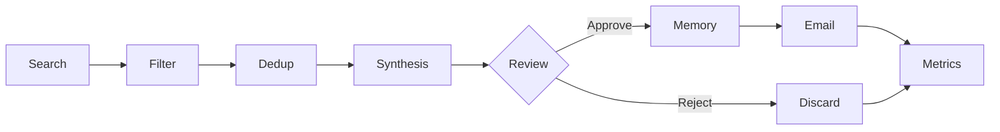

# Signal

**Autonomous Indian startup intelligence.** A LangGraph pipeline that watches funding, hiring, and founder news, throws out the same story when four outlets cover it, and emails a briefing only after a human approves it.

<p>
  
  
  
  
  
</p>

Built as a product, not a chat demo: sign-in, a live pipeline, a review gate, saved briefings, per-item feedback, and run metrics.

| | |
|---|---|
| **91%** | Entity extraction on 25 real Indian startup articles. Zero parse errors. Zero category violations. |
| **0.85** | Cosine threshold on `text-embedding-3-small`. Checked on real multi-publication story sets before the pipeline was written. |
| **30 days** | A finding is dropped only when its date parses and is older than this. A missing date is kept, with a confidence penalty. |
| **$0.50** | Hard cap per run, enforced before a large Tavily result can fan out into uncapped model calls. |

## What a run does



Search hits Tavily (domain-restricted), YC, Hacker News, and Google News. Freshness, scope, and the cheap dedup stages run in Python before GPT-4o mini extracts entities. GPT-4o writes the briefing once. The graph then pauses on `interrupt()`.

**Approve** writes episodic memory, then sends the email, then records metrics. Memory is a graph edge in front of Gmail, so a failed send does not erase what the next run must dedup against.

**Reject** logs the discard and records metrics. It does not write episodic memory and it does not send mail.

## The hard part

The same Series A shows up on Inc42, YourStory, Economic Times, and an aggregator in one week. Different URL, different headline, same event. URL match and title match both miss it.

Dedup is staged so the expensive check runs last:

1. Normalized company name + announced date
2. Exact URL against episodic memory
3. Normalized title
4. Embedding similarity at 0.85, title plus a short snippet

Stale republishes are the other failure mode. An old round comes back with a fresh URL and yesterday's timestamp. Freshness runs before any extraction call, so that article never becomes a model bill.

## Production shape

| Decision | Why it is in the graph |
|---|---|
| One `StateGraph` | Research → filter → dedup → synthesis → review is a sequence. A swarm adds coordination and no extra judgment. |
| Filters before the LLM | Freshness, scope, and early dedup are deterministic. Entity extraction only sees survivors. |
| Postgres for everything | Checkpoints, the memory store, briefings, and vectors sit in Supabase with pgvector. The run can pause for review and resume on the same `thread_id`. |
| Auth on every route | Supabase JWT. Briefings, feedback, and memory are scoped to the signed-in user. |
| Reject stays out of memory | A declined draft must not train future dedup. The conditional edge is the enforcement, not a flag inside the writer. |
| Traced and measured | LangSmith on every node. Each run stores retrieved, dropped-fresh, dropped-scope, dropped-dedup, tokens, cost, duration, and source health. |

Per-item useful / not-relevant ratings are stored as rows. Preference changes are counted signals, not an LLM rewriting its own profile.

Sources evaluated and left out: Twitter/X and Crunchbase on cost, LinkedIn scraping on terms.

## Run

Python 3.11, a Supabase project, and keys for OpenAI, Tavily, and LangSmith. Gmail is required only on approve.

```bash
python -m venv venv
pip install -r requirements.txt
copy .env.example .env   # Windows. On macOS/Linux: cp .env.example .env
```

Fill `.env` from `.env.example`. Point `frontend/config.js` at `http://localhost:8080` while developing, and put the hosted API URL back before you push.

```bash
uvicorn api.main:app --host 0.0.0.0 --port 8080
python -m http.server 8000 --directory frontend
```

Open `http://localhost:8000`. One approve should pass Saving memory → Sending briefing → Recording metrics and clear the review banner.

## Where to look

`agent/graph.py` wires the graph. `agent/nodes/hitl.py` is the pause. `api/` is FastAPI, auth, and the scheduler. `frontend/index.html` is the dashboard. `database/schema.sql` is the schema. `Docs/` holds the PRD, architecture, decisions, and eval gates. `validation/` holds the frozen datasets those gates run against.
